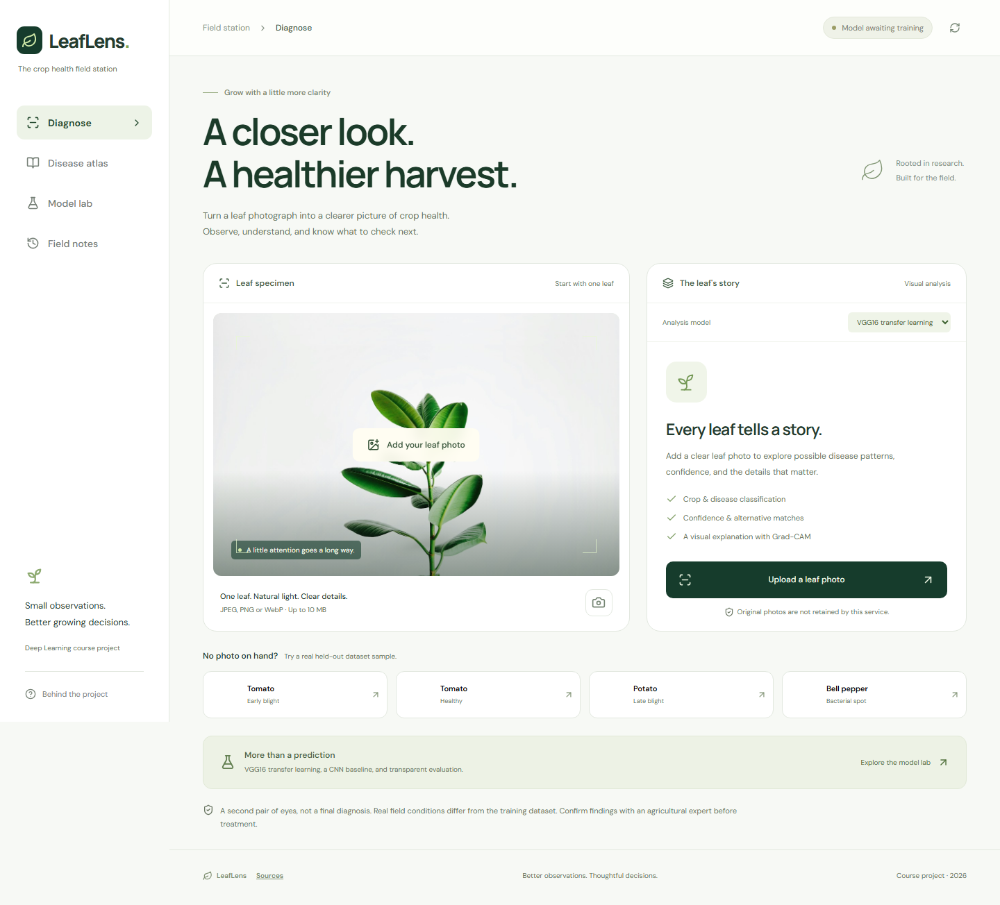

# LeafLens

**A closer look. A healthier harvest.**

**Live app:** [leaflens-black.vercel.app](https://leaflens-black.vercel.app)

A crop leaf disease research application with a botanical UI, a custom CNN baseline, VGG16 transfer learning, Grad-CAM explanations, measured evaluation and local field notes.

| Team | Registration |
|---|---|
| Atul Biju | ASI23CA023 |
| Athul M B | ASI23CA022 |
| Athul Chandran | ASI23CA021 |



## Run locally on Windows

Requires Python 3.11–3.13, Node.js 22+ and Git. From this folder:

```powershell
.\scripts\setup.ps1
.\scripts\start.ps1
```

Open **http://127.0.0.1:8000**. The built frontend is served by FastAPI, so only one service is required. Setup installs dependencies and builds the UI. It does not silently download a large dataset.

If a trained checkpoint is already in `artifacts/vgg16/best.pt`, diagnosis works immediately. Otherwise the app honestly shows that a model is awaiting training. The Model lab can still show committed measured experiment snapshots. To download the project's model release (requires GitHub access to this repository):

```powershell
.\.venv\Scripts\python.exe scripts/fetch_models.py
```

For a GPU environment, run `scripts/setup.ps1 -Cuda`; tested CUDA wheels target CUDA 12.8 and require a compatible NVIDIA driver. CPU inference works independently of GPU availability.

## Dataset and reproducible training

Assigned source: [PlantVillage — Kaggle](https://www.kaggle.com/datasets/emmarex/plantdisease). The chosen dataset variant covers **15 classes, 3 crops**: tomato, potato and bell pepper.

```powershell
.\.venv\Scripts\python.exe scripts/download_data.py
$env:TORCH_HOME = "$PWD/data/torch-cache"
.\.venv\Scripts\python.exe -m ml.train --data data/PlantVillage --architecture cnn --epochs 12
.\.venv\Scripts\python.exe -m ml.train --data data/PlantVillage --architecture vgg16 --epochs 12 --freeze-epochs 4
```

If Kaggle bandwidth or access is limited, a clearly documented alternative uses authentic images from the original authors' repository:

```powershell
.\.venv\Scripts\python.exe scripts/download_subset.py --per-class 100
.\.venv\Scripts\python.exe -m ml.train --data data/PlantVillage-subset --architecture cnn --max-per-class 100 --image-size 128 --epochs 12
.\.venv\Scripts\python.exe -m ml.train --data data/PlantVillage-subset --architecture vgg16 --max-per-class 100 --image-size 128 --epochs 12 --freeze-epochs 4
.\.venv\Scripts\python.exe scripts/publish_results.py
```

The upstream subset is **not** reported as a full Kaggle benchmark. Exact source commit, file selection and preprocessing fingerprint are recorded. Both models use identical seed and split settings; compare their manifest fingerprints before comparing results. Do not run both training jobs concurrently on a 4 GB GPU. Reduce batch size if memory is insufficient.

`notebooks/LeafLens_Training.ipynb` provides a Colab-friendly workflow. Full training can be much slower than a subset experiment.

## What's substantial about the project

- Four-block CNN baseline versus ImageNet-pretrained VGG16 with a compact classification head.
- Frozen-head training followed by last-block fine-tuning at a lower learning rate.
- Decoded-pixel duplicate removal **before** seeded stratified 70/15/15 splitting.
- Training-only augmentation, imbalance weights, dropout, label smoothing and early stopping.
- Accuracy, macro/weighted F1, per-class scores, confusion matrix, learning curves and calibration error.
- Grad-CAM overlays, ranked alternatives and a transparent low-confidence review threshold.
- Responsive UI, atlas search, local history, JSON export, keyboard controls and recoverable errors.
- Report, presentation, viva notes, API tests, browser tests, CI and Docker support.

## Hosting on Vercel

The complete application, including both trained models, runs on Vercel. The hosted upload limit is **4 MB**; local execution defaults to 10 MB. Deployment uses a curated CPU-only package and Vercel's large-function support. See [deployment instructions](docs/DEPLOYMENT.md) for setup, preview checks, production promotion and rollback.

## Development and checks

```powershell
.\.venv\Scripts\python.exe -m pytest -q
cd frontend
npm ci
npm run build
npx playwright install chromium
npm run test:e2e
```

Browser tests expect the API on port 8000. For hot reload, run the API in one terminal and `npm run dev` in `frontend/` in another. Vite proxies `/api` to the backend. Uploaded photos are handled in memory and are not saved by the backend. Field notes (thumbnails and results) remain in this browser until deleted. The introductory photograph is a static decorative asset, not a model input or dataset sample.

## Structure

```text
backend/       FastAPI routes, checkpoint inference, class library
ml/            splits, architectures, training, metrics, Grad-CAM
frontend/      React UI and browser tests
scripts/       setup, downloads, result publishing, model release retrieval
notebooks/     training walkthrough
docs/          methodology report, viva notes, presentation, measured results
data/          downloaded dataset and pretrained weights (ignored)
artifacts/     checkpoints and live experiment outputs (ignored)
```

## Academic material

- [Methodology report](docs/REPORT.md)
- [Presentation](docs/PRESENTATION.html) — open in a browser; arrow keys move between slides
- [Viva and demonstration notes](docs/VIVA.md)
- [Experiment record](docs/EXPERIMENTS.md)
- [Asset/source attribution](docs/SOURCES.md)

## Practical limits

This is closed-set research classification, not a confirmed diagnosis. PlantVillage's controlled images do not establish field performance. Softmax probabilities are uncalibrated; the 0.70 caution threshold is a heuristic, not validated unknown-disease detection. Exact duplicate isolation does not establish physical-leaf independence. Grad-CAM is not lesion segmentation or disease severity. Confirm observations with an agricultural expert before treatment. See the report for the complete evaluation boundaries.

Dataset, pretrained weights and trained binary checkpoints are distributed separately from Git source. Measured JSON results and screenshots are committed; checkpoints are available through the model release when published.
